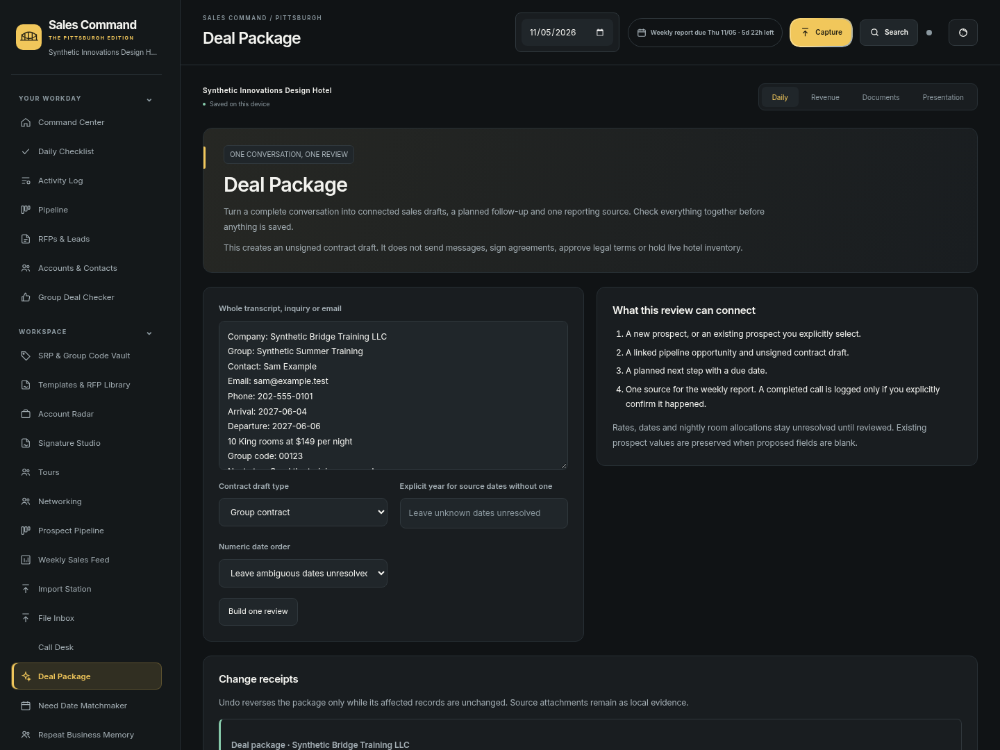
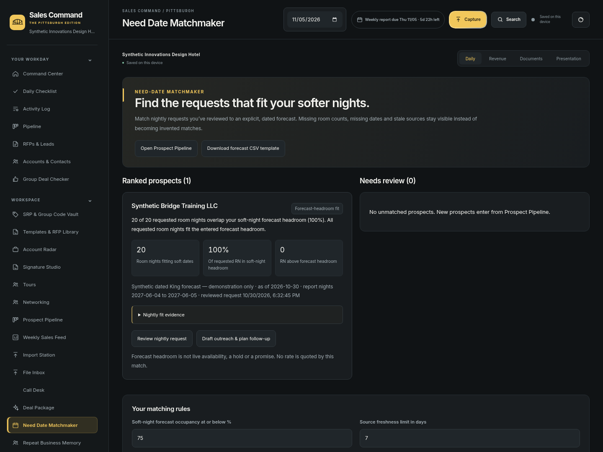
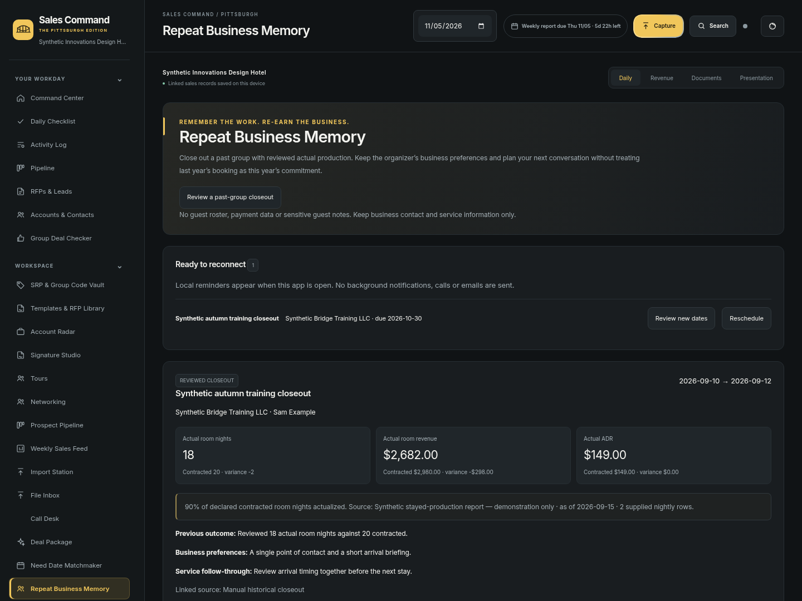
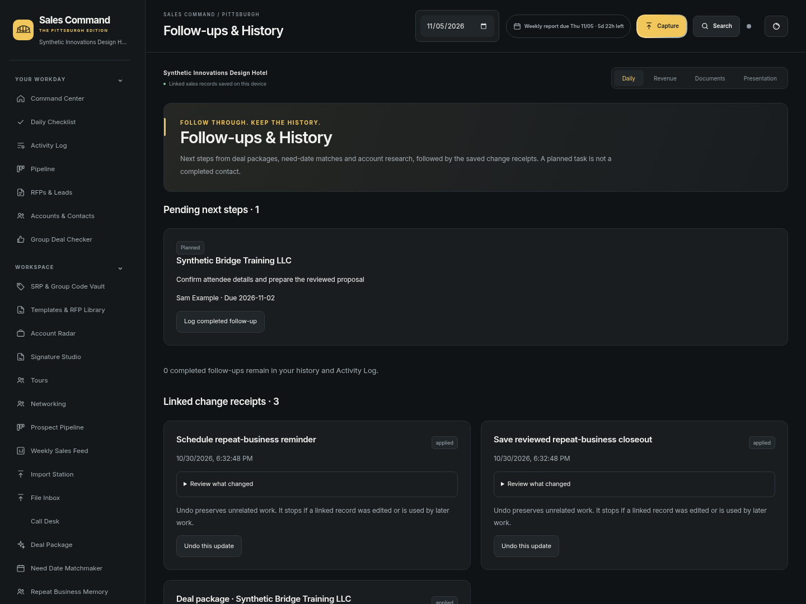

# Complete workflow preview

These are actual browser screenshots with synthetic data. The three previously proposed innovations are implemented.

[How to use and install](COMPLETE-UPDATE.md) · [Worker review](COMPLETE-TEAM-REVIEW.md) · [Validation](INNOVATIONS-VALIDATION.md)

## One conversation, one combined review

[Phone view](screenshots/innovations-eliza-production-deal-package-phone.png) · [Before/after receipt](screenshots/innovations-eliza-production-package-receipt.png)

## Match reviewed requests to slower nights

[Phone view](screenshots/innovations-eliza-production-need-dates-phone.png)

## Remember actual results and re-earn the account

[Phone view](screenshots/innovations-eliza-production-repeat-business-phone.png)

## Follow through and keep the change history

[Phone view](screenshots/innovations-eliza-production-follow-ups-phone.png)

## Pittsburgh stays included

[Four-theme gallery](PITTSBURGH-PREVIEW.html) · [Stadium desktop](screenshots/pittsburgh-stadiums-desktop.png) · [Stadium phone](screenshots/pittsburgh-stadiums-phone.png) · [Actual animation MP4](screenshots/pittsburgh-river-animation.mp4)

## Final production workflow evidence

The rebuilt release also has independently inspected QA captures: [saved package and receipt](screenshots/innovations-deal-package-desktop.png), [forecast evidence](screenshots/innovations-need-dates-desktop.png), and [actual closeout/reminder on phone](screenshots/innovations-repeat-business-phone.png).
